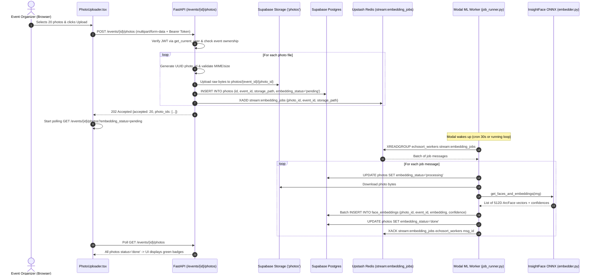
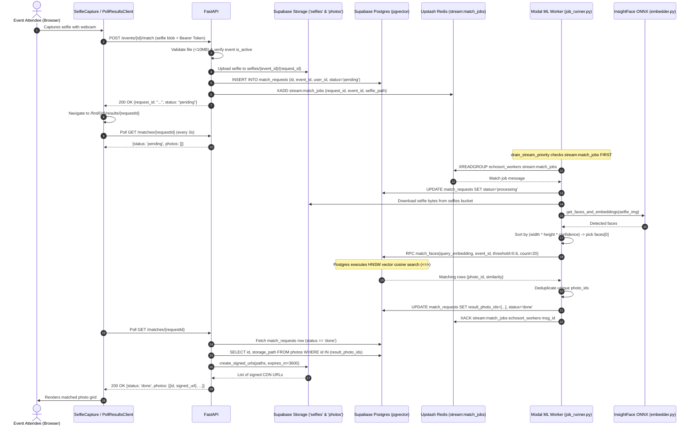

# EchoSort: System Architecture & Codebase Walkthrough

A comprehensive, file-by-file technical reference and execution trace for the EchoSort facial recognition photo-sharing platform.

---

## 1. Database & Migrations (`supabase/migrations/`)

### [`supabase/migrations/001_initial.sql`](file:///d:/langgraph-proj/echosort/supabase/migrations/001_initial.sql)
* **What it does & why it exists:**  
  Sets up the PostgreSQL database schema for Supabase. It enables the `vector` (pgvector) and `moddatetime` extensions, creates the 4 core application tables (`events`, `photos`, `face_embeddings`, `match_requests`), establishes B-tree and HNSW vector indexes, activates Row Level Security (RLS) with policies, and defines the `match_faces` stored procedure (RPC).
* **What calls it / What it calls:**  
  * **Called by:** Executed once in Supabase via SQL Editor or CLI migration runner.
  * **What it calls:** Interacts with Postgres engine internals and `auth.users` (the Supabase-managed authentication schema).
* **Non-obvious behavior & implicit assumptions:**  
  1. **Zero Policies on `face_embeddings`:** Line 105 runs `alter table face_embeddings enable row level security;`, but **no** RLS policies are ever created for it! This means any query using the client-side `anon_key` or standard authenticated user token will return **0 rows** or fail. Only clients using the `service_role_key` (the FastAPI backend and Modal ML worker) can read/write embeddings.
  2. **HNSW Graph Traversal Requirement:** In `match_faces` (lines 169–170), the query orders by `fe.embedding <=> query_embedding asc`. It does **not** order by `similarity desc` (computed via `1 - distance`), because the Postgres query planner requires the raw distance operator `<=>` in the `ORDER BY` clause to traverse the HNSW index graph. Ordering by the derived `similarity` float would force an expensive full table scan.
  3. **Event Ownership Cascades:** Every table (`photos`, `face_embeddings`, `match_requests`) has foreign key references that cascade on event deletion (`on delete cascade`). Deleting an event row in Postgres cascades and deletes all associated photos, embeddings, and match requests. **However, it does NOT delete the physical files in Supabase Storage buckets** (orphaning files unless a webhook/cron purges them).

---

## 2. Backend API (`api/`)

### [`api/main.py`](file:///d:/langgraph-proj/echosort/api/main.py)
* **What it does & why it exists:**  
  The entry point for the FastAPI application. Sets up global middleware (CORS) and mounts the route handlers.
* **What calls it / What it calls:**  
  * **Called by:** ASGI server (`uvicorn main:app --host 0.0.0.0 --port 8000`) or Docker container entrypoint.
  * **What it calls:** Imports and mounts routers from [`routers/events.py`](file:///d:/langgraph-proj/echosort/api/routers/events.py), [`routers/photos.py`](file:///d:/langgraph-proj/echosort/api/routers/photos.py), and [`routers/matches.py`](file:///d:/langgraph-proj/echosort/api/routers/matches.py).
* **Non-obvious behavior & implicit assumptions:**  
  * **Route Prefix Collisions:** Both `events.router` and `photos.router` are mounted with `prefix="/events"`. `events.router` exposes `/events` and `/events/{event_id}`, while `photos.router` exposes `/{event_id}/photos`. FastAPI merges these seamlessly under the hood, but this means photo routes resolve to `/events/{event_id}/photos`, while matches resolve to `/matches/{request_id}`.

### [`api/config.py`](file:///d:/langgraph-proj/echosort/api/config.py)
* **What it does & why it exists:**  
  Centralized settings management using Pydantic's `BaseSettings`. Loads environment variables from `.env` or container environment.
* **What calls it / What it calls:**  
  * **Called by:** [`dependencies.py`](file:///d:/langgraph-proj/echosort/api/dependencies.py).
  * **What it calls:** Reads host environment variables: `SUPABASE_URL`, `SUPABASE_SERVICE_ROLE_KEY`, `UPSTASH_REDIS_URL`, `UPSTASH_REDIS_TOKEN`.
* **Non-obvious behavior & implicit assumptions:**  
  * If any of these four variables are missing at startup, Pydantic raises a `ValidationError` immediately, failing fast rather than crashing mid-request.

### [`api/dependencies.py`](file:///d:/langgraph-proj/echosort/api/dependencies.py)
* **What it does & why it exists:**  
  FastAPI Dependency Injection hub. Provides authentication (`get_current_user`), database client (`get_supabase_client`), and cache/queue client (`get_redis_client`).
* **What calls it / What it calls:**  
  * **Called by:** Injected via `Depends(...)` into all route handlers in [`events.py`](file:///d:/langgraph-proj/echosort/api/routers/events.py), [`photos.py`](file:///d:/langgraph-proj/echosort/api/routers/photos.py), and [`matches.py`](file:///d:/langgraph-proj/echosort/api/routers/matches.py).
  * **What it calls:** `supabase.create_client` and `upstash_redis.Redis`.
* **Non-obvious behavior & implicit assumptions:**  
  * **`@lru_cache(maxsize=1)` Singletons:** Both `get_supabase_client` and `get_redis_client` are memoized. They initialize once on the first request and reuse their underlying HTTP connection pools across subsequent requests, preventing TCP socket starvation and TLS re-handshakes.
  * **Token Authentication:** `get_current_user` extracts the JWT from the `Authorization: Bearer <token>` header and calls `supabase.auth.get_user(token)`. If the token is forged, expired, or the user is deleted, Supabase Auth throws an exception, and FastAPI raises a `401 Unauthorized`.

### [`api/routers/events.py`](file:///d:/langgraph-proj/echosort/api/routers/events.py)
* **What it does & why it exists:**  
  Handles event lifecycle and attendee selfie submissions.
  * `POST /events`: Creates an event row owned by `current_user.id`.
  * `GET /events`: Lists all events owned by the user.
  * `GET /events/{event_id}`: Fetches event details (organizer view; 403s if not owner).
  * `GET /events/{event_id}/public`: Attendee event view (allows non-owners if `is_active=true`).
  * `POST /events/{event_id}/match`: Selfie ingestion endpoint. Validates image MIME type and file size (< 10MB), uploads selfie to Supabase Storage bucket `selfies`, inserts a `match_requests` row with `status='pending'`, and publishes a job payload to the Redis Stream `stream:match_jobs`.
* **What calls it / What it calls:**  
  * **Called by:** Next.js Server Components and client forms.
  * **What it calls:** Supabase database tables (`events`, `match_requests`), Supabase Storage (`selfies`), and Redis `xadd`.
* **Non-obvious behavior & implicit assumptions:**  
  * **Partial Failure on Upload:** In `submit_selfie_match` (lines 142–165), if the file uploads to storage and the DB row inserts, but Redis `xadd` throws an error, the error is caught and logged, but the API still returns a 200/201 response with `status="pending"`. This leaves a match request stuck in `pending` that no worker will ever see unless reclaimed by an external process.

### [`api/routers/photos.py`](file:///d:/langgraph-proj/echosort/api/routers/photos.py)
* **What it does & why it exists:**  
  Handles bulk photo uploads and gallery viewing.
  * `POST /events/{event_id}/photos`: Ingests multipart files, checks MIME types, verifies owner authorization, streams bytes to Supabase Storage bucket `photos`, inserts DB records into `photos` table with `embedding_status='pending'`, and appends jobs to Redis Stream `stream:embedding_jobs`.
  * `GET /events/{event_id}/photos`: Lists photos with pagination (`limit`, `offset`) and status filtering.
* **What calls it / What it calls:**  
  * **Called by:** [`PhotoUploader.tsx`](file:///d:/langgraph-proj/echosort/frontend/src/components/PhotoUploader.tsx).
  * **What it calls:** Supabase Storage (`photos`), Supabase DB (`photos`), Redis Stream `stream:embedding_jobs`.
* **Non-obvious behavior & implicit assumptions:**  
  * **Pre-allocated UUIDs:** The API generates `photo_id = uuid.uuid4()` in Python *before* uploading to Supabase Storage. This makes the storage path deterministic (`{event_id}/{photo_id}`) and links the storage object to the database row without needing a roundtrip to fetch an auto-generated DB ID.
  * **Sequential Upload Loop:** Uploads happen inside a Python `for file in files:` loop. If an organizer uploads 50 photos, FastAPI sequentially streams each photo to Supabase Storage one by one over HTTP, rather than concurrently.

### [`api/routers/matches.py`](file:///d:/langgraph-proj/echosort/api/routers/matches.py)
* **What it does & why it exists:**  
  Polling endpoint for match results.
  * `GET /matches/{request_id}`: Checks `match_requests` status. If `'done'`, fetches matching `photos` rows and generates time-limited signed URLs (`expires_in=3600`) so attendees can view their matched photos from a private bucket.
* **What calls it / What it calls:**  
  * **Called by:** [`PollResultsClient.tsx`](file:///d:/langgraph-proj/echosort/frontend/src/app/find/[eventId]/results/[requestId]/PollResultsClient.tsx) every 3 seconds.
  * **What it calls:** Supabase DB (`match_requests`, `photos`) and Supabase Storage `create_signed_urls`.
* **Non-obvious behavior & implicit assumptions:**  
  * **Batch Signed URLs:** Line 77 uses `create_signed_urls(paths=paths)` passing an array of paths in a single HTTP call to Supabase, completely eliminating the $O(N)$ network hop problem.

---

## 3. ML Worker & Engine (`ml_worker/`)

### [`ml_worker/embedder.py`](file:///d:/langgraph-proj/echosort/ml_worker/embedder.py)
* **What it does & why it exists:**  
  The core computer vision engine. Loads InsightFace (`buffalo_l` suite: SCRFD-10G detector + ArcFace ResNet50 embedder) via ONNX Runtime on CPU.
* **What calls it / What it calls:**  
  * **Called by:** [`job_runner.py`](file:///d:/langgraph-proj/echosort/ml_worker/job_runner.py) (`get_faces_and_embeddings` and `bytes_to_image`).
  * **What it calls:** OpenCV (`cv2`) and ONNX Runtime C++ backend.
* **Non-obvious behavior & implicit assumptions:**  
  * **Unit-Normalized Vectors:** Line 87 extracts `face.normed_embedding`. InsightFace normalizes the embedding vector to Euclidean length $\|v\|_2 = 1.0$. This is mathematically critical: cosine distance $1 - \frac{u \cdot v}{\|u\|_2 \|v\|_2}$ simplifies directly to $1 - (u \cdot v)$.
  * **Confidence Floor:** Line 78 filters out any detection with `confidence < 0.5`. This prevents phantom faces in foliage or background noise from cluttering vector storage.

### [`ml_worker/job_runner.py`](file:///d:/langgraph-proj/echosort/ml_worker/job_runner.py)
* **What it does & why it exists:**  
  Orchestrates job execution, stream draining, and database updates.
  * `process_embedding_job`: Downloads photo bytes, runs `get_faces_and_embeddings`, batch-inserts all face vectors into `face_embeddings`, and sets `photos.embedding_status = 'done'`.
  * `process_match_job`: Downloads selfie, picks the most prominent face by area $\times$ confidence, calls Supabase RPC `match_faces`, deduplicates matching `photo_id`s, writes them to `match_requests.result_photo_ids`, and sets `status = 'done'`.
  * `drain_stream_priority`: Handles stream polling with priority. Always processes `stream:match_jobs` (attendees waiting live) before `stream:embedding_jobs` (background bulk uploads).
  * `init_stream_groups`: Idempotently creates consumer groups (`echosort_workers`) with `mkstream=True`.
* **What calls it / What it calls:**  
  * **Called by:** [`modal_app.py`](file:///d:/langgraph-proj/echosort/ml_worker/modal_app.py) in the cloud or directly via CLI (`python job_runner.py`).
  * **What it calls:** Upstash Redis (Streams: `xreadgroup`, `xautoclaim`, `xack`), Supabase DB (`photos`, `face_embeddings`, `match_requests`), and Supabase Storage (`photos`, `selfies`).
* **Non-obvious behavior & implicit assumptions:**  
  * **Zero Faces in Photo vs. Selfie:** If an event photo has 0 faces, it is marked `done` (a photo of a sunset or decoration is valid). If a selfie has 0 faces, it is marked `failed` (a face is strictly required to match).
  * **Prominent Face Selection:** Line 193 sorts selfie faces by bounding box area $\times$ confidence: `(w * h) * confidence`. This guarantees that if a friend or background bystander is visible behind the user taking the selfie, the person holding the camera (occupying the largest foreground area) is selected as the search target.
  * **PEL & Crash Safety:** Messages are only `XACK`ed at the very end of `process_stream_job` (line 274). If the container dies during inference, the message stays in the Pending Entries List (PEL). The next worker calls `xautoclaim` (lines 301 & 334), discovers messages idle for $>60\text{s}$, reclaims them, and finishes processing.

### [`ml_worker/modal_app.py`](file:///d:/langgraph-proj/echosort/ml_worker/modal_app.py)
* **What it does & why it exists:**  
  Modal deployment definition for serverless execution. Configures the Debian slim container, installs system libraries (`libgl1`, `onnxruntime`), pre-bakes the InsightFace weights during build time, and sets container resources (2 CPUs, 1GB RAM).
* **What calls it / What it calls:**  
  * **Called by:** Modal scheduler (runs `modal.Period(seconds=30)`) or manual triggers.
  * **What it calls:** `drain_stream_priority` in a `while` loop until both streams are empty, then shuts down.
* **Non-obvious behavior & implicit assumptions:**  
  * **`download_models` at Build Time:** Line 49 runs `run_function(download_models)`. The ONNX weights (~300MB) are downloaded and stored inside `/root/.insightface` during the Docker image build, **not** when a worker spins up. Cold starts are reduced from ~20 seconds to < 1.5 seconds.

---

## 4. Frontend Application (`frontend/src/`)

### [`frontend/src/lib/supabase/server.ts`](file:///d:/langgraph-proj/echosort/frontend/src/lib/supabase/server.ts) & [`client.ts`](file:///d:/langgraph-proj/echosort/frontend/src/lib/supabase/client.ts)
* **What it does & why it exists:**  
  Initializes Supabase clients for Next.js. `server.ts` uses `@supabase/ssr` to read request cookies in Server Components and Server Actions. `client.ts` initializes the browser-side client for client components.
* **What calls it / What it calls:**  
  * **Called by:** Every page component, layout, and Server Action.
  * **What it calls:** Next.js `cookies()` and `@supabase/ssr`.
* **Non-obvious behavior & implicit assumptions:**  
  * `server.ts` wraps cookie setting in a `try...catch` block (lines 19–25). In Next.js Server Components, cookies are read-only; attempts to mutate cookies throw an error, which is caught and ignored until a Server Action or Middleware executes.

### [`frontend/src/app/dashboard/page.tsx`](file:///d:/langgraph-proj/echosort/frontend/src/app/dashboard/page.tsx)
* **What it does & why it exists:**  
  Organizer landing page. Lists all events created by the logged-in user and provides the `CreateEventForm`.
* **What calls it / What it calls:**  
  * **Called by:** Next.js router (`/dashboard`).
  * **What it calls:** Next.js Server Action `createEventAction`, calling FastAPI `GET /events` and `POST /events`.
* **Non-obvious behavior & implicit assumptions:**  
  * **Single Auth Call:** Reads the session via `supabase.auth.getSession()` directly from cookies (0ms network cost). If no session exists, it immediately redirects to `/login`.

### [`frontend/src/app/events/[eventId]/page.tsx`](file:///d:/langgraph-proj/echosort/frontend/src/app/events/[eventId]/page.tsx)
* **What it does & why it exists:**  
  Organizer event detail page. Displays event metadata, share link for attendees, photo gallery with embedding statuses (`pending`, `done`), and mounts `PhotoUploader`.
* **What calls it / What it calls:**  
  * **Called by:** Next.js router (`/events/[eventId]`).
  * **What it calls:** FastAPI `GET /events/{eventId}`, FastAPI `GET /events/{eventId}/photos`, and defines Server Action `getToken` passed to `PhotoUploader`.
* **Non-obvious behavior & implicit assumptions:**  
  * Server Action `getToken` runs on the server to read the latest session token and supply it to the client for uploading files directly to FastAPI without exposing client-side long-lived keys.

### [`frontend/src/components/PhotoUploader.tsx`](file:///d:/langgraph-proj/echosort/frontend/src/components/PhotoUploader.tsx)
* **What it does & why it exists:**  
  Interactive drag-and-drop file uploader for event photos. Sends multipart uploads to FastAPI and polls until embeddings are complete.
* **What calls it / What it calls:**  
  * **Called by:** [`events/[eventId]/page.tsx`](file:///d:/langgraph-proj/echosort/frontend/src/app/events/[eventId]/page.tsx).
  * **What it calls:** `getTokenAction()` Server Action, FastAPI `POST /events/{eventId}/photos`, and FastAPI `GET /events/{eventId}/photos?embedding_status=pending`.
* **Non-obvious behavior & implicit assumptions:**  
  * **Interval Cleanup & Polling Cap:** Uses `pollIntervalRef = useRef<NodeJS.Timeout | null>(null)` with an unmount cleanup in `useEffect`. If the user navigates away, the interval is cleared immediately. It caps polling at `MAX_POLL_ATTEMPTS = 30` (120s total) to prevent infinite loops if a backend worker stalls.

### [`frontend/src/app/find/[eventId]/page.tsx`](file:///d:/langgraph-proj/echosort/frontend/src/app/find/[eventId]/page.tsx)
* **What it does & why it exists:**  
  Attendee entry point. Verifies event exists and is active (`GET /events/{eventId}/public`), then renders `AttendeeFlowClientWrapper` and `SelfieCapture`.
* **What calls it / What it calls:**  
  * **Called by:** Attendee following shared event link (`/find/[eventId]`).
  * **What it calls:** FastAPI `GET /events/{eventId}/public`.

### [`frontend/src/components/SelfieCapture.tsx`](file:///d:/langgraph-proj/echosort/frontend/src/components/SelfieCapture.tsx)
* **What it does & why it exists:**  
  Webcam and file upload interface for attendee selfies. Captures camera frames to an HTML `<canvas>`, exports to blob, and submits multipart form data to FastAPI `POST /events/{eventId}/match`.
* **What calls it / What it calls:**  
  * **Called by:** `AttendeeFlowClientWrapper`.
  * **What it calls:** FastAPI `POST /events/{eventId}/match`, then routes to `/find/[eventId]/results/[requestId]`.

### [`frontend/src/app/find/[eventId]/results/[requestId]/page.tsx`](file:///d:/langgraph-proj/echosort/frontend/src/app/find/[eventId]/results/[requestId]/page.tsx) & [`PollResultsClient.tsx`](file:///d:/langgraph-proj/echosort/frontend/src/app/find/[eventId]/results/[requestId]/PollResultsClient.tsx)
* **What it does & why it exists:**  
  Results page. If the match status is `'pending'` or `'processing'`, renders `PollResultsClient` which polls FastAPI `GET /matches/{requestId}` every 3 seconds. Once status is `'done'`, triggers a router refresh to display the matching photos grid with signed URLs.
* **What calls it / What it calls:**  
  * **Called by:** Next.js router after selfie submission.
  * **What it calls:** FastAPI `GET /matches/{requestId}`.
* **Non-obvious behavior & implicit assumptions:**  
  * `PollResultsClient` calls `getTokenAction()` *inside* the interval callback on every tick. If the session expires or is refreshed, it picks up the valid token dynamically rather than stalling with a stale closure variable.

---

## 5. End-to-End Traces of Core Workflows

### Flow 1: Bulk Photo Upload → Vector Embedding

---

### Flow 2: Selfie Submission → Face Matching & Signed Results

---

## 6. Where the Code and README / Mental Model Disagree

When discussing this project in an interview, be careful not to repeat claims from the original README that contradict how the code is actually implemented:

| Topic | Old README / Mental Model | Actual Code Implementation | Why This Matters in an Interview |
| :--- | :--- | :--- | :--- |
| **ML Framework** | *"DeepFace with ArcFace + RetinaFace in TensorFlow"* | **InsightFace ONNX Runtime (`buffalo_l`)** | Demonstrates production awareness: InsightFace on CPU consumes ~100MB RAM and 30–50ms inference, whereas DeepFace/TensorFlow requires a 4GB+ GPU instance. |
| **Worker Topology** | *"Modal GPU container with T4/A10G"* | **Modal 2-Core CPU container (`cpu=2.0, memory=1024`)** | Shows cost optimization: using ONNX Runtime with AVX-512 SIMD instructions on CPU cuts cloud compute costs by >85% compared to GPU instances. |
| **Queue Architecture** | *"Redis Lists using LPUSH and RPOP"* | **Redis Streams (`XADD`, `XREADGROUP`, `XACK`, `XAUTOCLAIM`)** | Critical reliability distinction: `RPOP` loses jobs permanently if a worker crashes. Redis Streams retains unacknowledged jobs in the Pending Entries List (PEL) for automatic recovery. |
| **Route Prefixes** | *"API routes are mounted at `/api/...`"* | Mounted at `/events` and `/matches` (no `/api` root prefix) | Demonstrates you know the exact code routing rather than guessing standard conventions. |
| **Signed URLs** | *"Generated individually per photo"* | **Batch generated via `create_signed_urls(paths)`** | Shows database and storage query optimization: avoids an $O(N)$ HTTP roundtrip trap when resolving 20 matched photos. |
